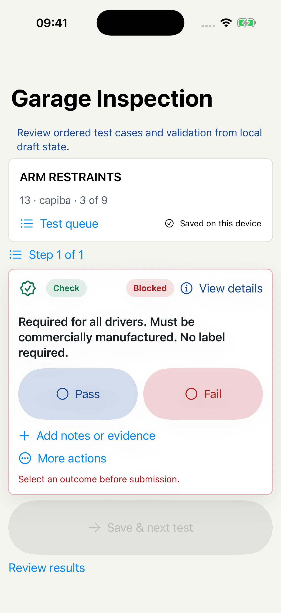

# Task 00 - baseline

Source: workflow/baseline component commit containing this checkpoint.
Branch: simplified-ui-redesign
Scheme: FSAEInspectionChecklist
Validation: direct Xcode26.2 simulator build passed; XcodeBuildMCP was unavailable.
Device: iPhone 17 Pro / iOS26.2, retained UDID 34AA36AD-2704-4759-A347-01A023DEB371.
DerivedData: /tmp/FSAESimplifiedUIDerivedData
Launch: -inspection-snapshot focus

This is the predecessor screen, captured from a DEBUG-only isolated fixture. It shows the same clutter as the supplied screenshot. It does not modify a judge session and proves rendering rather than native touch interaction. Capture was accepted by the boot-screen gate and visually inspected.
