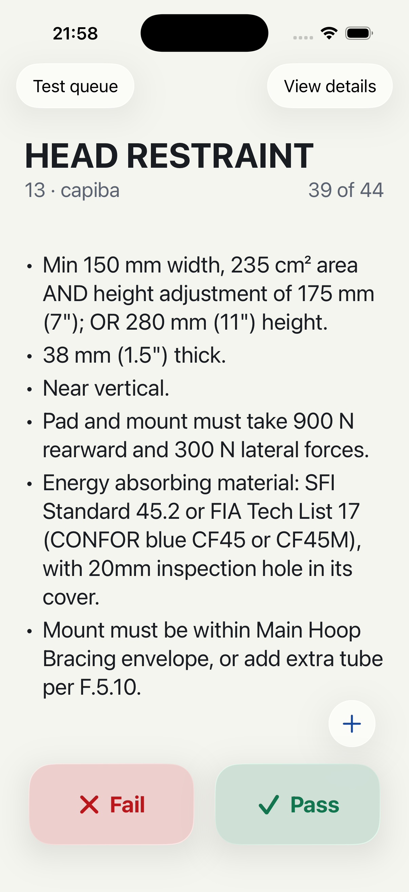

# Glass execution controls and requirement bullets

Reviewed on iPhone 17 Pro / iOS 26.5 with Xcode 26.6.

- Explicit single-newline requirements render as bullets with 6-point spacing and aligned wrapped lines.
- Description text uses Dynamic Type title2 (22 points at default size).
- Value/unit pairs use non-breaking spaces; JSON structure and wording are preserved.
- Fail/Pass controls float over scrolling criteria, retain light semantic glass tints after selection, and stack at accessibility sizes.
- A pencil opens Edit mode. Notes and validation messages use distinct opaque reading surfaces.
- The rounded test queue, disabled session switching, and persistence confirmation gate are preserved.

Validation: XcodeBuildMCP simulator build and visual review passed. The 22 focused content/result tests passed before the final typography-only changes; no persistence or navigation behavior changed afterward. Native gestures, VoiceOver, and physical-device ergonomics still need manual review.

