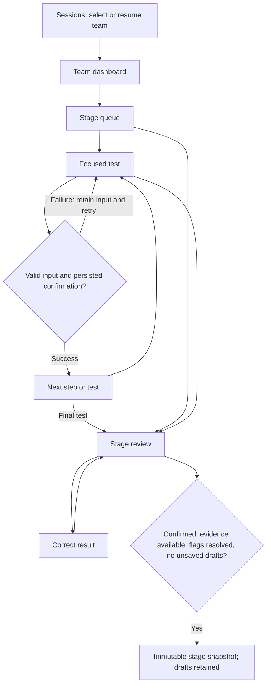

# System Map: Judge Inspection Flow

This map describes the current simplified inspection implementation. See [validation](validation.md) for the exact source last tested and [known issues](known-issues.md) for unresolved defects.

## Judge journey

Select or resume a local team session in Sessions, open a stage from Team, then use the stage queue to continue inspection or select a test. Focus shows essential criteria, safety warnings, schema-driven input, optional actions, and top-right details. Save & next confirms only after persistence succeeds. The final step opens review; review can also be opened early. Correcting a result returns to review, and native Back follows the same coordinator history.

## Screens and navigation ownership

| Surface | Source / owner | Behavior |
| --- | --- | --- |
| Root tabs | `App/ContentTabsView.swift`, `ContentViewBindings` | Sessions and Team; Internal Settings in DEBUG. `.stageChecklist` selects Team and presents its stage destination. There is no separate Stage tab. |
| Sessions | `SessionSelectorView`, `SessionSelectionCoordinator` | Local roster; Add Team opens `CreateTeamSheet`. Distinct display-name/car-number bindings produce a typed `LocalTeamCatalogEntry`. Close icon has the accessible Cancel label. |
| Team | `ActiveTeamDashboardView`, `InspectionExecutionCoordinator` | Per-stage draft progress and current stage; debug actions obey Internal Settings. Dashboard completion uses broad draft validation, distinct from focused confirmation/submission gates. |
| Stage queue / focus / review | `FullStageView`, `StageFocusCoordinator` | Native destinations via `StageExecutionDestination`; selected case/step, correction origin, queue sections and review scroll state. Tab visibility follows persistent focus mode. |
| Focused input | `FocusedResultView`, `FocusedResultForm` | Local field ownership, debounced serial saves, explicit durable confirmation, failure retry, notes, measurement, photos, preview/retake. Form identity includes case and step; stage identity includes event/session/team/stage. |
| Review | `StageReviewView`, `StageReviewCaseView`, `StageSubmissionAction` | Whole-card correction, required-input/confirmation/flag blockers, immutable submission and recoverable failure. |
| Details / photos | `FocusedTestDetails`, photo source picker/camera/library surfaces | Rules and full instructions; debug display and type badge require Internal Settings. |

`TestCaseView`, `StepOverviewView`, and `StageChecklistView` were removed. Do not use predecessor screen names as current navigation.

## Coordinator and service map

- `AppCoordinator` owns mock login/root selection, team creation and top-level stage/submission intents.
- `InspectionEventCoordinator` owns event/session lifecycle and creates the execution coordinator when starting or resuming a session.
- `InspectionExecutionCoordinator` owns session context, stage drafts, failed-save tracking and frozen stage submission. Legacy case/step routes remain as adapters into focused stage destinations.
- `StageFocusCoordinator` owns queue/focus/review destination history, current selection, review correction return targets and confirmed advancement. Native Back truncates that same history.
- `InspectionContentService` loads six official bundled JSON stages; content models and validation services remain shared.
- `InspectionEventStore` applies event/team/session access and scope, then delegates to persistence services.

## Persistence and confirmation

Draft files remain test-case scoped beneath Application Support: `events/<event>/teams/<team>/sessions/<session>/drafts/<stage>/<test-case>.json`. `FocusedResultForm` serializes revisions; the execution coordinator chains whole-case writes and keeps failed cases dirty until recovery. Editing clears explicit confirmation. Failed confirmation retains input and must not advance.

Review submission calls `AppCoordinator.submitActiveStage` → `InspectionExecutionCoordinator.submitActiveStage` → `InspectionEventStore.submitStage` → `SubmissionSnapshotService.createStageSnapshot(preserveDrafts: true)`. It rejects empty stages, unconfirmed/invalid results, missing local required evidence, unresolved flags and unsaved drafts. Snapshots use a captured copy; later edits do not rewrite historical submission JSON. The submitted indicator is in-memory state, not a history browser.

`FocusedResultEvidenceStore` copies photo bytes atomically into Application Support `Evidence/`, with relative paths in attachment metadata. Replacement removes the old metadata only after import succeeds; historical assets are retained. Physical camera capture remains a manual-validation gap.

## Current limits and risks

- Team switching intentionally returns false; reset/session history, rechecks, sticker eligibility, improvements 11–15 and concurrency cleanup remain deferred.
- Dedicated UI automation is pending. DEBUG snapshot/replay fixtures are appearance evidence, not native gesture or VoiceOver coverage.
- Dashboard draft progress/completion and focused confirmation use different gates. A completed-looking draft is not proof of a submitted stage.
- The Add Team stall was reported with Xcode attached; the same installed app was responsive after Home Screen launch. Internal cause unresolved. Failed PR #104 and closed, unmerged optional scheme PR #106 are outside #107.
- Known actor-isolation warnings remain; the successful build is not a warning-free or strict-concurrency certification.
- Keep current findings in known-issues and source-qualified checks in validation; remove superseded results when refreshing evidence.
